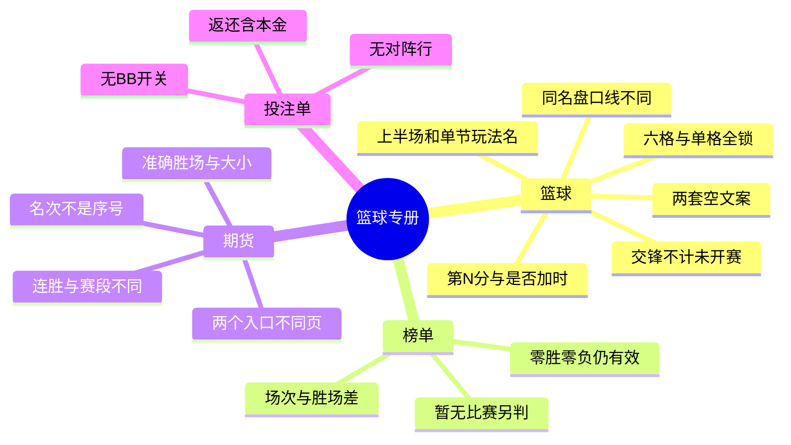

# 篮球体育界面：测试点

只留篮球专册里核心页没写清的点。投注单通用规则、顶栏和页脚见 [体育测试点](../sports/test-points.md)。

原型：https://y4wz1q.axshare.com/?id=tp1mlc&p=体育｜篮球

配套用例：[test-cases.md](test-cases.md)

## 思维导图

## 篮球

- 单格锁只禁该选项；六格全锁才是整场主线不可投。让分灰字是线，黄字是赔率。
- 注单写完整玩法名，例如「让分（含加时）」「第 4 节 — 让分」。上半场只算前两节。
- P2 07:08 是第 2 节剩余，TE 02:22 是加时剩余，不是比分。
- 「未找到搜索结果」和「此刻没有赛事」不是同一句。刷新后排序和时间窗保留，搜索词清空。
- 字母筛的是地区西语首字母。I 只留国际、以色列。
- 是否进入加时只问会不会打加时。20:28 时「第 49 分归属」选的是累计第 49 分的球队。
- 42.5 和 43.5 是两个条件。得分最多的节比的是各节合计，候选是节次。平局退款退的是本金。
- 交锋不计未开赛。样本已赛 2 胜 2 负，场均 83.5 对 88.0。12:16 加 8:12 等于 20:28。
- 球员合计正负值是各球员之和，可以是 +35，不等于净胜 7 分。

## 榜单

- 0 胜 0 负、胜率 0.0 仍是有效榜。比赛显示「暂无可用比赛」时，榜单仍要单独判断。
- 场次＝胜＋负。32 胜 8 负为 40 场。榜首胜场差是横线，落后值可以是 3.5。

## 期货

- 「第 3 名」是最终分区名次，不是列表序号。样本顺序保持 3、2、1、4、5。
- 准确 45 场必须恰好 45 胜。大于 45.5 是至少 46 胜，小于 45.5 是至多 45 胜。
- 最长连胜大于 3.5 是至少一次 4 连胜，和累计胜场不同。反向队名是另一项。附加赛和季后赛是两个玩法。
- 主页面的期货进入目录，联赛页的期货进入该联赛。

## 投注单

- 期货注单只有候选、赔率和完整玩法名，没有主客对阵行，也没有 BB。
- 马刺 +270、本金 100，返还 370.00，含本金，净收益 270。同一冠军市场的球队互斥。
