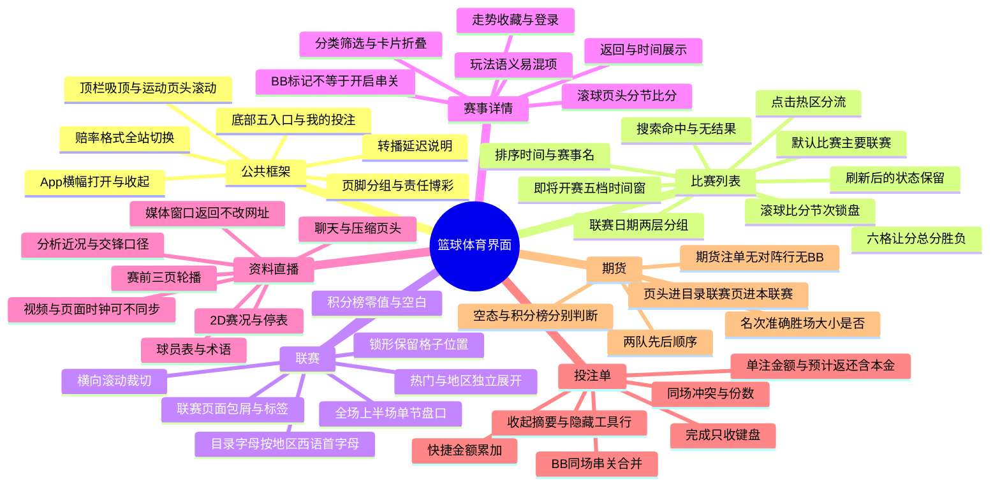

# 篮球体育界面：关键测试点与思维导图

范围是原型「体育-足球-20260914」里链接直接打开的篮球纵向：`体育｜篮球` 及其四个子页（联赛比赛与榜单、赛事玩法交互、资料与直播、期货目录与玩法）。公共顶栏、底部导航、赔率格式和投注单以篮球页上的标注为准。其他运动项目共用同一套外壳，玩法字段不在本清单里展开。

原型地址：https://y4wz1q.axshare.com/?id=tp1mlc&p=体育｜篮球

配套用例：[test-cases.md](test-cases.md)

## 思维导图

## 主路径

首页运动横栏点篮球 → 比赛 / 主要联赛 → 滚球或即将开赛（排序、搜索、时间窗）→ 点比赛信息进详情「投注」；点赔率留在当前页并打开所选面板。

联赛标签 → 字母筛选 → 展开地区 → 点联赛进比赛页。期货标签是独立目录；联赛页上的期货只进该联赛期货。

## 关键测试点

### 1. 点击去向不能串

| 热区 | 结果 |
| --- | --- |
| 队名、开赛时间、媒体图标、玩法数 | 进赛事详情，落在「投注」 |
| 六格赔率 | 留在列表，打开所选投注；再点同一格取消 |
| 联赛标题 / 目录格 / 右箭头 | 进该联赛比赛页 |
| 一级「期货」 | 进期货目录，不直接打开冠军玩法 |
| 联赛页「期货」 | 进该联赛期货 |
| 人形 + 人数（938、9999+） | 不跳转；和玩法徽标「数量 + 双箭头」不是同一个控件 |
| 媒体窗口左上返回 | 只关媒体，网址不变，仍在详情 |
| 普通页头返回 | 回进入前的页面 |
| 底部「我的投注」 | 历史投注，不是未提交的所选面板 |

列表行不放收藏星。收藏只在详情玩法卡上，未登录先提示登录。

### 2. 列表行与六格盘口

- 先列完一个联赛再出现下一个。每个日期头重复「让分 / 总分 / 胜负」。
- 上行为主队、下行为客队。长名称单行省略。赛前只显示开赛时刻，不显示实时比分。
- 让分：灰字盘口线、黄字赔率。主队 −1.5 结算扣 1.5 分，客队 +1.5 加 1.5 分。
- 总分：上 O 大于、下 U 小于，分界是两队合计。
- 胜负：格内只有赔率。当前主线含加时，注单里要写出完整玩法名，例如「让分（含加时）」。
- 锁形表示该选项当前不可选。六格全锁才表示整场主线盘口都不可选。单个锁形不显示赔率，也不能加入投注。
- 球场图标是 2D，播放三角是视频，竖条是统计。列表里点这些图标只进详情，不在列表展开播放器。

### 3. 滚球、排序、搜索、即将开赛

- 滚球行：`P2 07:08` 是第 2 节剩余 7 分 08 秒；`TE 02:22` 是加时剩余。旁边是当前比分。
- 排序默认时钟（按比赛时间），A-Z 按赛事名。两项菜单，红勾为当前项，点选即重排并关闭，点外部关闭。刷新后保留。与滚球大厅共用。
- 搜索输入即过滤，无需回车。`Royal` 只留皇家勇士及联赛头；`zzzz` 为「未找到搜索结果」，清空文字恢复。框内没有清空按钮。滚球和即将开赛共用搜索词，刷新后清空。
- 即将开赛默认未来 3 小时，另有 15 分钟、30 分钟、1 小时、2 小时。行内是开赛时刻，不是倒计时，没有实时比分。
- 「此刻没有赛事」是空时间窗；「未找到搜索结果」是搜索无命中。两套文案不能混用。
- 刷新后：回到主要联赛；排序和时间窗保留；搜索词清空。

### 4. 联赛目录与积分榜

- 字母筛的是地区名称的西语首字母，不是联赛名搜索。选 I 只留国际、以色列，热门隐藏，第一组自动展开。
- 多组可同时展开。奇数末行右格留空，不拉伸。
- 联赛页标签按数据出现。没有期货的样本只有「比赛」「积分榜」。
- 盘口范围默认全场，可切上半场、单节。列头仍是让分 / 总分 / 胜负，节次写在注单完整玩法名里。欧篮联样本切上半场后六格全锁；墨西哥样本只锁胜负列。格子位置都保留。
- 上半场只对应前两节。
- 积分榜：场次 = 胜 + 负。胜场差是落后榜首的胜场，榜首为横线，可以为 3.5。0 胜 0 负是有效榜单，不是空态。
- 「暂无可用比赛」和「正文空白（暂无排名资料）」分开。比赛空不代表积分榜空。NBA 杯是无比赛但已有零值排名。
- 榜单 PTS 是联赛积分；球员表 PTS 是个人得分。球队行不可跳转。
- 墨西哥样本需要横向滑动才看全积分列，滑过后左侧名次和队名会被裁切。

### 5. 赛事玩法（最容易测错）

- 分类默认「全部」。右箭头把分类换行铺开，再点收起。切分类只筛本场玩法。
- 卡片上的绿色 BB 只折叠 / 展开卡片，不是打开同场串关。真正开启组合是注单里的 BB 开关，或先选中「同场串关」分类。
- 「显示更多」一次展开剩余盘口，按钮消失。没有「显示更少」。各卡展开状态独立。
- 胜负（含加时）只有主、客，没有平局。常规时间三项结果含 X 平局，且在加时前判定。
- 半场 / 全场是九宫格。「主 / 客」表示半场主队领先、全场客队获胜。
- 是否进入加时是「会不会打加时」，不是「加时内谁获胜」。
- 单双看该时段两队合计分的奇偶。81:74 合计 155 为单，82:74 合计 156 为双。
- 得分最多的节：先把每节双方得分相加再比大小。候选是节次，不是球队。并列不能写成唯一命中。
- 第 N 分归属：例 20:28 已有 48 分，选的是打出全场累计第 49 分的球队。不是「某队先得 49 分」，也不是净胜 49 分。
- 平局退款：所选队在该玩法时段内获胜才命中，平局退本金。
- 第 1 节总分 42.5 和 43.5 是两张同名卡，盘口线不同就是不同条件。
- 滚球页头用节次、剩余时间和即时比分替换倒计时。小号分节比分按节排列，当前节为黄色。12:16 与 8:12 相加为 20:28。
- 走势图：横轴时间，历史行绿上箭头 / 红下箭头表示相邻报价变化。关闭后保留已选项。

### 6. 资料、球员、分析、聊天

- 赛前 2D 是三页轮播：倒计时、排名近况、获胜概率 / 交锋胜率。获胜概率和交锋胜率不是赔率，也不是已发生赛果。
- 计时暂停要保留阶段和剩余时间，不能当成比赛结束。
- 视频加载中是深色画面加水印。视频时钟和页面比分时钟可以不同步。关闭播放器不退出详情。
- 球员表：姓名列固定，14 项数据横滑。红字是该列最高，并列都标红。蓝色姓名不跳转。合计包含未展示球员。合计正负值是各球员之和，不等于球队净胜分。
- 分析「近况」勾选后，用近五场替换胜负等列。不足五场不补齐。下划线是最新一场。
- 交锋统计只用已完成比赛。未开赛有时间、无比分，不计入胜负和场均。筛选后会排除不符合的记录，并按场次数补入更早的符合记录。
- 「去投注」回到投注标签并回到页顶。
- 聊天选中后数字气泡隐藏。投注标签的红点红字是常驻标识，不能靠红色判断是否选中。页头压缩后，投注固定在标签栏最左。

### 7. 投注单与金额

- 未填金额时下注按钮为灰色。四档快捷金额是累加，不是覆盖。完成只收起键盘，金额和选项保留。
- 预计返还含本金。例：本金 100、美式 −115（小数 1.87）→ 返还 187.00，净收益 87.00。期货 +270、本金 100 → 返还 370.00，净收益 270。
- 组合报价和返还用系统返回值。不能用已经舍入的美式赔率反算精确值。原型里两场串关出现过 224.40 和 224.39 两个返回值，以当次接口为准。
- 同场不同玩法不能普通互串，左侧黄条加顶部「部分所选项无法组合」。再加另一场后，可组合的按份数显示，例如 2×100 = 200。
- BB 把同一场可组合结果合成一项。气泡仍计原始选项数（例：3 条选择，串关按 2 场计）。关闭 BB 恢复冲突。期货页不展示 BB，不要在期货里补这个开关。
- 「隐藏选项」只藏清空 / BB / i 工具行。「向下箭头」收起整面板，底部摘要仍在。两者分开测。
- 再次点同一赔率，或点 ×，移除选项。最后一项移除后面板收起。清空全部清掉所有选择。

### 8. 期货语义

- 目录没有「全部赛事」标题，也没有比赛页的三个胶囊。同名联赛在「联赛目录」进比赛页，在「期货目录」进期货页。
- NBA 杯可以有目录入口，进去是「暂无可用赛事」，但积分榜可以已有零值排名。
- 「第 3 名」是该球队最终分区名次，不是列表序号。样本顺序是 3、2、1、4、5，不能重排成 1 到 5。
- 准确 45 场必须恰好 45 胜。大于 45.5 是至少 46 胜，小于 45.5 是至多 45 胜。
- 最长连胜大于 3.5 是至少一次 4 连胜。累计胜场和连续胜场分开统计。
- 尼克斯 / 凯尔特人与凯尔特人 / 尼克斯是两项独立候选。不是两场比赛，也不是五队完整排名。
- 进入附加赛和进入季后赛是不同玩法。同一冠军市场的互斥候选不能当成可以同时获胜。
- 期货注单只有候选、赔率、完整玩法名，没有「主队 — 客队」对阵行。

## 建议优先级

| 级别 | 先测什么 |
| --- | --- |
| P0 | 点击分流、六格含义、锁盘、单注金额与返还、同场冲突、BB 合并、取消与收起 |
| P1 | 滚球行、排序搜索、时间窗、联赛盘口范围、积分榜零值与空态、玩法语义、期货候选含义 |
| P2 | 横幅页脚、轮播、视频延迟、球员横滑、聊天、赔率格式展示 |

登录、注册、真实扣款和账户校验在原型里只保留入口，不在这组用例里展开提交。
