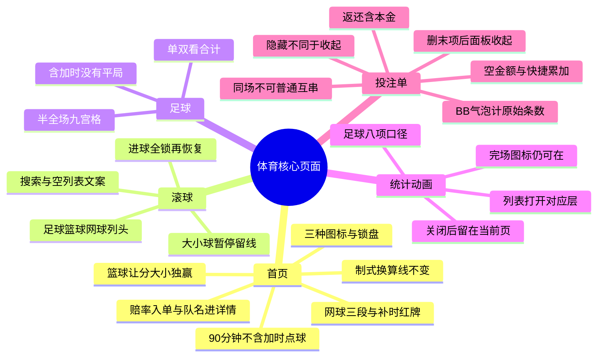

# 体育核心页面：测试点

范围是体育首页、滚球大厅、足球详情、统计与 2D／视频、投注单。样本数字来自原型，上线后改用同一盘口的接口值。篮球联赛、榜单和期货见 [篮球测试点](../sports-basketball/test-points.md)。

原型：https://y4wz1q.axshare.com/

配套用例：[test-cases.md](test-cases.md)

## 思维导图

## 首页

- 点赔率加入投注单，再点取消；点队名进详情。灰锁不可选。
- 足球 1／X／2 只算 90 分钟加补时，不含加时和点球。晋级方可以不同。
- 同一主胜 +114 = 2.14 = 57/50。制式只改赔率，−5.5、170.5 这类盘口线不变。
- 篮球 −5.5 需净胜至少 6 分；大小分比两队合计；独赢只选谁赢。
- 网球蓝为本局、红为本盘局数、白为盘数。谢尔顿 0／0／2 对阿尔卡拉斯 0／2／1 是第 4 盘第 3 局。
- 红色 +3 是补时 3 分钟。队名后红块是红牌。
- 播放三角是视频，球场图标是 2D，三柱是技术统计。

## 滚球

- 进球后先全锁再恢复：2:0、56:30、−500／+550／+1000 → 2:1、56:35 全锁 → 2:1、56:45、−250／+300／+650。
- 大小球暂停时 2.5 还在，下行赔率变锁。
- 「未找到搜索结果」和「你还没有收藏」不是同一句。
- 足球用 1／X／2、大小球或是／否；网球默认 1／2；篮球默认让分、大小分、独赢。

## 足球

- 含加时胜负没有平局。常规时间才有平局，且在加时前判定。
- 半全场九格：斜线前是半场，斜线后是全场。Dortmund／Dortmund −121 不等于整场主胜 −271。
- 单双看合计奇偶。81:74 合计 155 为单，82:74 合计 156 为双。

## 统计动画

- 从列表点图标，打开的是对应层，不是详情里的另一个入口。关闭后仍留在当前页。
- 已结束比赛仍可能有图标，不等于还在比，也不等于有回放。
- 足球八项：进攻、危险进攻、控球率、射正、射偏、角球、黄牌、红牌。松林队／海港队为 68／51、37／28、55%／45%、4／2、6／4、5／3、2／1、0／0。
- 停表仍是第 2 节 05:12，不是完场。视频时钟可以和页面不一致。获胜概率 91%／9% 不是赔率。

## 投注单

- 没金额不能下注。+10、+50、+100、+500 在当前金额上累加。完成只收键盘。
- +100、本金 100，返还 200.00，含本金。7.5 的返还是 15.00。
- 同一场不能普通互串。注单 BB 合并后气泡仍计原始条数；报价 +243、本金 100 的返还是 343.11。
- 卡片上的 BB 只折叠卡片，和注单里的 BB 开关不是同一个控件。
- 「隐藏选项」只收工具行。收起整个面板只留摘要。最后一项删除后面板收起。
- 报价从 +100 变为 −102 后要再确认，金额仍在。三串一返还 651.81，已含加奖 16.07。
