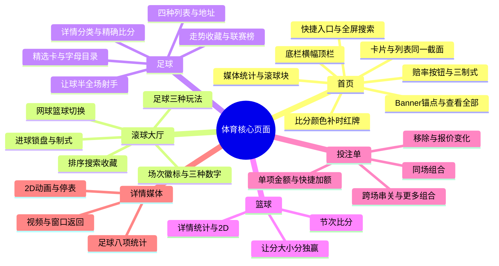

# 体育核心页面：测试点

范围是原型「体育-足球-20260914」里用户指定的页面：体育首页、滚球大厅、足球、篮球、投注单，以及滚球赛事详情上的统计、2D 动画和视频。样本数字（美洲狮 UNAM 主胜 +114、松林队／海港队八项统计、科隆胜 +100 返还 200.00、同场组合返还 343.11 等）来自页面标注，上线后用同一盘口的接口返回值替换，阅读规则不变。

不展开其余运动项目的玩法字段。篮球联赛目录、积分榜、期货和球员表的完整用例仍在 [篮球测试点](../sports-basketball/test-points.md) 与 [篮球测试用例](../sports-basketball/test-cases.md)。本文件只保留这些页面上必须一起验收的篮球规则。

原型：https://y4wz1q.axshare.com/

配套用例：[test-cases.md](test-cases.md)

## 思维导图

## 主路径

首页运动横栏进滚球大厅、足球或篮球 → 列表里点赔率加入投注单，点对阵进入赛事详情。滚球详情里，播放三角进视频，球场图标进 2D 动画，三根竖柱进技术统计。投注单展开后填写金额；底部「我的投注」进入历史记录。

## 关键测试点

### 1. 首页框架与入口

| 热区 | 结果 |
| --- | --- |
| 运动横栏「滚球大厅」 | 汇总入口，进入滚球大厅。它本身不是一项运动 |
| 运动横栏「娱乐场」 | 游戏频道。截图顺序在棒球之后 |
| 足球、篮球等运动图标 | 进入该运动赛事列表 |
| 搜索框 | 全屏搜索页替换首页。占位为「搜索赛事名称或球队名称」 |
| Banner 卡片 | 可进活动、滚球大厅或赛事详情。圆点表示张数和当前张 |
| 锚点 Tab | 首页纵向滚到对应区块，并红色下划线。联赛标签只定位本页 |
| 「查看全部」 | 进入该联赛独立页 |
| 赔率按钮 | 选中该项并加入投注单 |
| 赛事行其余区域 | 进入该场详情 |
| 「N 场 ›」 | 滚球区块的比赛场数，进入滚球大厅 |
| 「173 ›」这类玩法数 | 本场玩法数量，进入该场详情 |
| 底部「我的投注」 | 历史记录，不是未提交的投注单 |
| 底部「娱乐场」 | 整条导航换成大厅、真人娱乐场、热门游戏、聊天室、返回体育区 |

运动横栏文档顺序：滚球大厅、足球、棒球、篮球、美式足球、网球、电竞、综合格斗、拳击、一级方程式。本次截图在棒球后还有娱乐场。

App 横幅的 × 只在本次访问隐藏，下方顶栏上移。横幅随页面滚走。品牌顶栏吸顶；有横幅和无横幅时，吸顶位置不同。

中奖跑马灯的金额是墨西哥比索，大额可写成 K，绿点表示实时内容，× 关闭该区域。热门游戏人数是正在玩这款游戏的人数，9,999+ 为显示上限。「查看全部」进入热门游戏集合。

页脚「主要赛事」是运营精选，和首页锚点「热门赛事」分开。支付图标共 15 种，合规标识共 5 项。图标不是余额。

### 2. 首页赔率、按钮和结算

- 足球 1／X／2：主胜、平局、客胜。全场最终结果按 90 分钟加补时结算，不含加时赛和点球大战。杯赛晋级方可以和本盘口获胜方不同。
- 美式 +114：投注 100，净赢 114。美式 −102：投注 102，净赢 100。净收益不含本金。小数含本金，分数是净收益／本金。
- 同一场美洲狮 UNAM／莱昂的同一个主胜：+114 = 2.14 = 57/50。热门卡片和列表一起改写法。球队、日期、时刻、比分、玩法数、选项顺序保持原义。
- 单层按钮只有赔率。双层按钮上层是盘口线，下层才是赔率。灰锁替换数字，按钮框保留，该格不可选。
- 只有同一场、同一玩法、同一盘口线、同一选项、同一时点、同一制式，才比较赔率和锁盘。
- 篮球让分：主队 −5.5 需净胜至少 6 分；客队 +5.5 表示获胜，或输分不超过 5。大小分 O／U 170.5 比较两队合计，和哪队获胜无关；−112 才是赔率。独赢直接选上方或下方球队获胜。
- 切换制式只改赔率写法。−5.5、+5.5、O／U 170.5 保持原样。左侧让分格里 −5.5 是盘口线，下面的 −105 才是赔率。

### 3. 首页比分颜色、补时和红牌

- 网球进行中：蓝字是本局分（0、15、30、40、A），红字是本盘已赢局数，白字是已赢盘数。绿点是当前发球方。谢尔顿 0／0／2、阿尔卡拉斯 0／2／1 表示本局 0 比 0、本盘 0 比 2、盘数 2 比 1，当前第 4 盘第 3 局。热门卡片只显示盘数 2:1。
- 郑钦文 30／4／1、莱巴金娜 30／3／1：本局 30 比 30，本盘 4 比 3，盘数 1 比 1，对应第 3 盘第 8 局。
- 已结束网球：红字 6 比 4 是最后一盘局分，白字 2 比 0 是盘分。不再显示蓝字本局分和发球点。赛况改为「已结束」，2D 图标保留，赔率锁定。该示例没有统计入口。
- 排球是两层计分。红字是当前盘得分，白字是已赢盘数。圣托马斯 13／0、永助 16／1：当前盘 13 比 16，已赢盘数 0 比 1，正在第 2 盘。乒乓球、羽毛球同样两层，阶段名称按该运动显示。
- 发球绿点用于回合制项目。足球和篮球不使用发球点。
- 足球红色 +3 是补时 3 分钟。队名后的红色小矩形是红牌。已结束示例第 3 行双方都有红牌，最终比分 2 比 4，三项赔率全锁。第 3 行保留视频图标，第 4 行保留 2D 图标，两行都保留统计入口。图标仍在，只说明入口还在。

### 4. 首页媒体、统计和滚球块

元信息从左到右：时间或赛况、足球补时、媒体图标、玩法数。三根竖柱在比赛信息区右端、赔率栏左侧。

| 图标 | 含义 |
| --- | --- |
| 方框里的播放三角 | 视频直播 |
| 球场中线与中圈 | 2D 实时动画 |
| 三根竖柱 | 技术统计 |
| 无媒体图标 | 本场未提供对应入口 |

足球统计八项：进攻、危险进攻、控球率、射正、射偏、角球、黄牌、红牌。关闭后回到该场赛事列表。测试行松林队／海港队：进攻 68／51，危险进攻 37／28，控球率 55%／45%，射正 4／2，射偏 6／4，角球 5／3，黄牌 2／1，红牌 0／0。其他运动按该页实际项目展示。

热门卡片和列表要核对同一场、同一时间截面：联赛、双方及顺序、开赛时刻、赛前或滚球、阶段和比分一致。卡片可以简写：卡片带星期，列表用日期分组头；网球卡片显示盘数，列表显示分、局、盘。

滚球块「14 场 ›」是区块比赛总数。每轮展示 5 个运动，每类最多 10 场。运动种类超过 5 个时轮流换 5 个，建议每 5 分钟轮换展示的运动。各场赔率按赛事刷新，和这 5 分钟轮换分开。组头按运动显示 1／X／2、1／2，或让分／大小分／独赢。

日期头按日／月／年。12/09/2026 是 2026 年 9 月 12 日。上方为主队或选项 1，下方为客队或选项 2。

### 5. 滚球大厅

- 运动条最左是收藏，其后只放当前有比赛的运动。选中项白字加白下划线。红色徽标是该运动进行中的场数。本次顺序含收藏、足球、棒球、篮球、网球、电竞、排球、冰球、斯诺克、羽毛球、室内足球、十三人制橄榄球、联合式橄榄球。
- 场次徽标、联赛头人数、单场玩法数是三种数字。9,999+ 是人数上限写法，红色不等于已经顶到上限。长联赛名省略，点击名称进该联赛。
- 排序两项：按赛事／联赛、按比赛时间。红勾为当前项，选后收起。固定对照里，按赛事是法国再意大利，按时间是意大利（29:10）再法国（30:11）。时间、比分、赔率不因排序改变。
- 足球玩法菜单和页脚赔率制式是两套控件。最终结果三格 1／X／2。进球大小球两格，上层是盘口线。双方都进球两格「是／否」。同一场多瑙维也纳 1:0、法沃里特 AC，65:14：最终结果 −218／+285／+540；大小球 2.5 的 −122／−120；双方进球 −182／+110。总进球 3 属于大于 2.5，总进球 2 属于小于 2.5。当前 1:0 仍是赛况。
- 搜索在当前运动标题下插入输入行，不替换成全屏页。输入 Donau 命中多瑙维也纳和多瑙克拉根福，并保留各自联赛头。顶部运动场次数不改成命中数。zzqv000test 显示「未找到搜索结果」。清空后恢复完整列表。
- 收藏里分「比赛」和「赛事」。空态文案是「你还没有收藏」。空态本身不等于未登录。
- 不来梅—汉堡 91:23，红色 +3 是补时，汉堡队名后红矩形是红牌。马奇菲尔德对霍恩：2:0、56:30、赔率 −500／+550／+1000 → 进球后 2:1、56:35、三格全锁 → 恢复后 2:1、56:45、−250／+300／+650。三格锁只说明这三个选项暂停。大小球暂停时两格仍保留 2.5，下行赔率换成锁。
- 切到网球后默认「比赛获胜者」，只有 1／2。郑钦文 40／4／1、莱巴金娜 A／3／1，赔率 +114／−148，第 3 盘第 8 局，玩法数 25。A 在发球方，40 在接发球方。暂停时比分保留、两格上锁。菜单还有本盘获胜者、总局数。
- 切到篮球后默认全场，三组为让分、大小分、独赢。科尔卡 75、萨格勒布迪纳摩 49，第 4 节 06:44，玩法数 8。让分 −25.5／+25.5 均为 −125，大小分 147.5 的大／小均为 −117，独赢列可见 +7400。范围菜单有全场、上半场、第 X 节。
- 赔率制式示例：同一主胜 +150 = 2.50 = 3/2。展开说明后，比分和时间仅供参考，结算看投注规则。底栏当前项是滚球大厅。

### 6. 足球列表、目录和详情

比赛地址 /soccer，联赛 /soccer/leagues，期货 /soccer/outrights。四个列表是重点联赛、重点球队、滚球、即将开始。滚球和即将开始只换列表内容。存款和 $0.00 是资金入口，余额不是报价。

- 重点联赛先按赛事再按日期。Dortmund—Werder Bremen，10 月 10 日 02:30，145 »，赔率 −271／+440／+580。02:30 是预计开赛时刻。
- 重点球队按球队分组。América 对 Monterrey，11:00，130 »，−121／+270／+290。同一球队可以出现在多个赛事里。赛事标题进专题，对阵和 » 进本场详情。
- 滚球行 Ezemvelo 0、Jvw 1、75:10、4 »，赔率 +6900／+470／−2500。75:10 是已进行时间。搜索 Ezemvelo 保留该场；zzzxxyy 为「搜索未找到结果」。清空只恢复当前列表，不进入独立搜索页。计时和报价会刷新，同一场可以从 75:10 变为 79:25。
- 即将开始默认未来 3 小时，另有 15 分钟、30 分钟、1 小时、2 小时。India—Brasil 22:00、93 »，+5900／+1600／−5000。行内是预计开赛时刻，没有进行中比分。
- 足球频道精选卡：科莫—帕尔马 00:30 周二，1／X／2 为 −417／+540／+1200，右上是 2D。班菲尔德—巴拉卡斯 06:00 周二，+133／+180／+235，右上是视频。00:30 是开赛时间。点角标进入所属比赛。长队名换行，长联赛名省略。空白队徽、灰盾和图形都保留位置。没有左右翻页按钮，右侧露出下一张。
- 红边是已选中，再点同一赔率取消。锁形替换赔率后该格不可选。0 项不显示选择单；1 项显示科莫 · −417；2 项显示二串一（2）和 +619。删第二项只取消都灵红边。
- 字母按地区西语原名筛选，名称可以是中文。选 A 隐藏热门并展开德国，选 B 展开巴林。回到「全部」后热门恢复展开，其余收起。20 个字母按钮六列换行，末行只有 T、U。前九个分组优先，其后按西语字母，中文译名不改变排序。多组可同时展开，奇数末行右格留空。

详情以 Dortmund—Werder Bremen 为准。队名链到球队页，德甲标题和期货候选分开。赛前显示 10 月 10 日 02:30 和「7 天后」。分类默认可见全部、创建投注、主要玩法，右箭头展开 11 项。切换分类只换玩法区。

- 胜平负 −271／+440／+580。双方进球是 −164、否 +124。
- 总进球默认 3 行：3.25、3.5、3.75。显示更多后为 7 行：2.75、3、3.25、3.5、3.75、4、4.25。3.5 的大于是 +100，小于是 −122。没有「显示更少」。
- 双重机会：1 或 X 为 −910，X 或 2 为 +165，1 或 2 为 −715。
- 精确比分滑块打开时，左右加减属于两队进球。从 0:0／+2100 到 Dortmund 2、Werder 1，候选为 2:1／+640。关闭滑块后变成三列网格：主胜、平、客胜。0:0／+2100 和 1:1／+840 各是一条候选。
- 0-0 返还只覆盖赛前指定比赛的精确比分或半场／全场，且 0-0 结束、该注未中、客户为新的合资格客户。条款入口 /promotions/sports/article12。点说明再点关闭，回到本场。
- 亚洲让球整场和上半场分开。Dortmund −1.75／+119 的卡片市场名是亚洲让球。0 盘口两队都显示 0，−500 和 +260 仍各属一格。三项让球 0:3 的三格是 +480／+480／−323，0:3 是参数，不是已发生比分。
- 组合表一行是赛果，两列是双方进球「是／否」。Dortmund 且是／+132 已包含两个条件，不把两格赔率相加。
- 半场／全场共九格。斜线前是半场，斜线后是全场。Dortmund／Dortmund 为 −121，和平局／Dortmund 的 +350、整场主胜 −271 各是一条候选。
- 射手每一行三列：任意时间、首个、最后。Guirassy 为 −157／+285／+275。默认 6 人，显示更多后 42 人、126 格。再点同一格取消。
- 创建投注先选双方进球「是」−164，再选主胜 −271，合并卡报价 +144。这个 +144 用页面给出的组合价。相关方向显示锁。BB 开启是一张卡；BB 关闭恢复两张单项卡，并提示部分选择不能组合。清空后仍留在本场创建投注列表。

走势从图标进入，× 关闭后回到本场盘口。下拉有 20 项，整场、上下半场和角球各自保留入口。玩法星标收藏的是整块玩法：整场胜平负变金星后移到第一块，双方进球原收藏保留；再点恢复原顺序。赛事页顶部星标收藏整场比赛。滚球大厅收藏页分类为比赛、联赛、球队、球员。取消赛事收藏后，玩法金星可以仍然保留。

德甲联赛页可以有比赛、期货、积分榜、统计四个标签。统计汇总先球员、后球队。球员页有统计项和球队两个下拉；球队页只有统计项。0 是有效数值。切换统计项保留已选球队，名次按筛选结果重排。圆形箭头把球员页恢复为进球和全部球队。切到球队统计再回到球员统计时，恢复默认。助攻榜的球队范围可以比红牌榜更宽。

### 7. 篮球在这些页面上的差异

首页和滚球大厅里的篮球使用让分、大小分、独赢，列结构不同于足球 1／X／2。盘口线不随赔率制式换算。滚球比分看节次和剩余时间，例如第 4 节 06:44。

详情媒体以「篮球赛事｜资料与直播」为准，因为足球标注写清了列表图标和八项统计浮层，2D 窗口本体写在篮球详情：

- 列表上的媒体小图标只负责进入详情。页头胶囊和详情标签是另外两组入口。
- 赛前 2D 三页轮播：开赛倒计时、排名与近况、获胜概率／交锋胜率。王牌排名 3、胜率 0.650，火花排名 4、胜率 0.575。获胜概率 91%／9%，交锋胜率 80%／20%。这两组百分比不是赔率，也不是已发生赛果。
- 滚球 2D 自上而下是画面、紧凑比分、分节表、技术统计。示例王牌 20:28 火花，第 2 节 05:12。未开始的节不填比分。两分 5:7、三分 2:3、罚球 4:5。计时暂停保留「第 2 节 05:12」和停表状态。
- 视频加载中是深色画面加水印。视频时钟和页面比分时钟可以不同步。关闭播放器后仍在赛事详情。窗口左上返回只关媒体，网址不变。普通页头返回才离开详情。
- 统计页只有全场胶囊。左主右客，较高的一侧用主队蓝或客队橙。20 个两分 + 10 个三分 + 11 个罚球 = 81 分，和球队合计 81:74 一致。布局和 2D 环形图不同。

联赛目录、六格列表、积分榜和期货见篮球专册，避免和本文件重复展开。

### 8. 投注单

底部「我的投注」是历史。投注单是点赔率后出现的所选面板。余额显示在投注单顶部，和投注金额分开。样本余额为 $0.00。

- 单项卡三行：选择和报价、市场名、完整对阵。科隆胜 +100、整场胜平负、科隆—门兴。金额为空时提交为灰色。+100 且本金 100 时，预计返还 200.00，净盈利 100.00。
- 快捷金额 +10、+50、+100、+500 是在当前金额上相加。100 再加 10 得 110，返还 220.00；再加 50 得 160，返还 320.00；再加 500 得 660，返还 1,320.00。7.5 在 +100 下返还 15.00。
- 「完成」收起键盘，100 显示为 100.00，选择和金额保留。「记住金额」关闭时灰点在左，开启时绿点在右。示例 107 的返还是 214.00。
- 同一候选从 +100 变为 −102 时，卡片上方出现「报价已变化」，金额仍为 100。提交入口变为「接受报价变化并提交」。短提示「所选项目的可用性已发生变化」和底部「接受变更」是两个组件，出现变化后需要再确认。
- 同场科隆胜 +101 与双方进球「是」−193，关闭组合时各有金额框，并提示「部分所选项无法组合」。开启后合成一张科隆—门兴卡，报价 +243，一个金额框。本金 100 的页面返还是 343.11。组合内还可以再展开两张单项卡，此时有三个金额框，只有组合框里的 100.00 保留。
- 关闭组合会清空原组合金额，两张单项卡金额为空。重新开启后金额仍为空，样本报价变为 +241。
- 「隐藏选项」只收起删除全部和组合工具行，卡片和金额保留，入口改成「显示选项」。条件上的 × 只移除该条件。组合卡左上 × 移除卡内全部条件。删除全部清掉当前选择和金额框，页面仍停在本场。
- 跨场：先选科隆胜 +104，进入弗赖堡—沙尔克后选择仍在，报价可变为 +102。再选弗赖堡胜 −137，收起条为二串一 +247。展开后二串一金额 100、报价 +242 时，返还 342.54。两张单项卡金额可以仍为空。
- 「显示更多组合」增加「单项 N 注」的每注金额。每注 50 时，两张卡各 50.00，单项本金 100.00；二串一原来的 100.00 仍单独保留。回到足球目录后再显示二串一，样本报价 +239，收起条金额框为空，提交不可用。
- 三场斯图加特胜 −121、不来梅胜 −125、法兰克福胜 −108。三串一报价 +535。单项每注 50：三张返还 91.50、90.00、96.50，本金 150.00，按钮返还 278.00。二串一 3 注每注 50 的本金是 150.00；三选四注是 200.00；三选七注是 350.00。只填一种时，其他金额框保持空。
- 三串一金额 100 的返还 651.81，其中已包含加奖 16.07。加奖说明写明选定联赛串关最高 50%，幅度随选择数变化。四注明细是三组二串一加一组三串一，明细本身不含加奖。七注再加三张单项。

足球页选择单的数学示例：科莫 −417、金额 100，预计返还约 123.98，含本金。多个项目才出现数量和摘要。

## 建议优先级

| 级别 | 先测什么 |
| --- | --- |
| P0 | 首页和列表的点击分流、赔率加入投注单、锁盘、足球 90 分钟结算、单项金额与返还、同场冲突、跨场串关、删除和报价变化 |
| P1 | 三制式对照、篮球盘口线、网球和排球比分、补时红牌、滚球玩法切换、搜索排序、足球详情玩法、统计八项、2D 与视频窗口 |
| P2 | 横幅页脚、轮播、跑马灯、字母目录、联赛统计榜、收藏星标、聊天和延迟说明 |

登录、注册、真实扣款和账户校验在原型里只保留入口。金额用例核对页面展示的本金、返还和净盈利关系，提交动作停在按钮状态。
